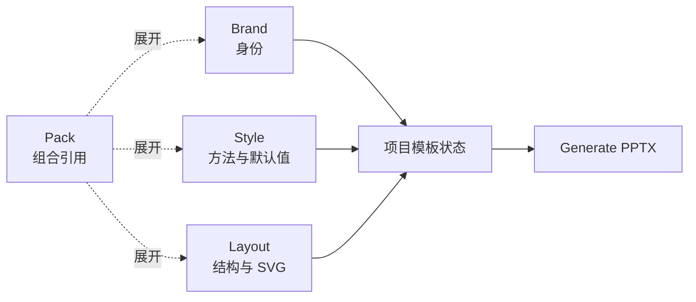

# 模板架构：Brand / Style / Layout / Pack

Template 是四种可复用资产的总称，不是第五种 Kind。



| Kind | 目录 | 所有权 | 禁止内容 |
|---|---|---|---|
| Brand | `templates/brands/<id>/` | 官方颜色、字体、Logo、语气、图标规则和品牌资产 | 页面结构、SVG roster、示例内容 |
| Style | `templates/styles/<id>/` | 表达方法、证据纪律、密度和非强制视觉默认值 | 品牌事实、几何、SVG、固定页序 |
| Layout | `templates/layouts/<id>/` | 画布、页面类型、语义槽位、几何和 SVG roster | 品牌身份、正式配色、表达方法、图例样式 |
| Pack | `templates/packs/<id>/` | 已注册组件引用、发现摘要和关键词 | 设计字段、资产、SVG、嵌套 Pack |

## Pack schema

```yaml
---
pack_id: <id>
kind: pack
summary: <summary>
brand_id: <brand id or null>
style_id: <style id or null>
layout_id: <layout id or null>
keywords: [<tags>]
---
```

至少两个组件引用非空。Pack 选择后先展开为 Brand、Style、Layout；显式选择的同 Kind 组件替换 Pack 引用。Pack 作为 `design_spec.pack.<id>.md` 保留来源，但不参与 Strategist 设计段读取。

## 选择与所有权

| 决策 | 所有者 |
|---|---|
| 身份 | Brand；未选择时由当前项目确认 |
| 方法和默认值 | Style；未选择时由当前项目决定 |
| 结构 | Layout；未选择时自由设计 |
| 组合来源 | Pack；只解析引用 |

一次最多选择一个 Pack。解析后每个基础 Kind 最多一个组件。多 Pack、未知引用、嵌套 Pack、Pack 资产和重复基础 Kind 都是硬错误。

## 注册索引

- `brands/brands_index.json`: `brand_id → {summary, primary_color}`
- `styles/styles_index.json`: `style_id → {summary, keywords}`
- `layouts/layouts_index.json`: `layout_id → {summary, canvas_format, page_count, page_types}`
- `packs/packs_index.json`: `pack_id → {summary, brand_id, style_id, layout_id, keywords}`

`register_template.py --kind` 必须显式选择 `brand | style | layout | pack`。索引是发现真相源；不得扫描未注册目录补充 UI 候选。

## PPTX 导入边界

用户提供的 PPTX 走 `Import Brand PPTX`，只形成项目级 Brand，不注册为 Pack 或 Layout。模板中的示例文字、图表图例、页面拓扑和对象几何均不进入 Brand。

这里删除的是模板资产 Kind。文档中的 source deck、output deck 等词仍表示实际演示文稿。
