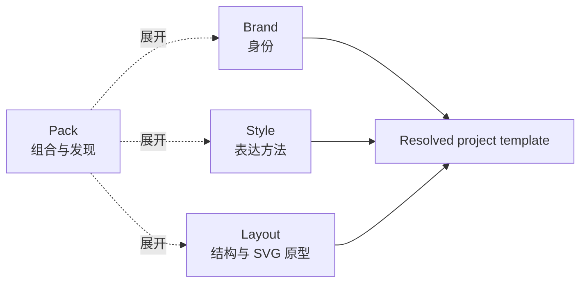

# Template Assets

Template 是可复用设计资产的总称，只有四种 `kind`：Brand、Style、Layout、Pack。
Deck 仅表示一次实际演示文稿，不再是模板资产类型。



| Kind | 目录 / 索引 | 所有权 | 当前数量 |
|---|---|---|---:|
| Brand | `brands/brands_index.json` | 颜色、字体、Logo、语气、品牌 Icon 规则 | 38 |
| Style | `styles/styles_index.json` | 表达方法、证据纪律、信息密度、视觉默认值 | 12 |
| Layout | `layouts/layouts_index.json` | 画布、页面结构、语义槽位、SVG 页面原型，以及可选的导入 Icon / Chart 视觉语法 | 55 |
| Pack | `packs/packs_index.json` | 至少两个基础 Kind 的引用、摘要和关键词 | 21 |

边界：Brand 不含页面原型；Style 不含身份事实或 SVG；Layout 不锁定品牌、
正式配色或字体；Pack 不含任何设计字段、SVG、图片或嵌套 Pack。图表、表格、
图标和音效是资源，不属于模板 Kind。例外是用户显式导入的 Icon / Chart Grammar
Layout：它可保存图标处理或数据系列调色板、图例、坐标轴、网格线和标签的视觉规则，
但不保存品牌身份、示例数据或源页面几何；图表调色板只作用于数据系列，不覆盖 Brand
的页面身份色彩。

Pack 选择后先展开为 Brand、Style、Layout。用户显式选择的基础组件覆盖
Pack 中同 Kind 的引用；Pack 只保留来源与恢复信息，不参与设计优先级。

```bash
python3 scripts/register_template.py <id> --kind brand
python3 scripts/register_template.py <id> --kind style
python3 scripts/register_template.py <id> --kind layout
python3 scripts/register_template.py <id> --kind pack
```

公共的 `Import Brand PPTX` 路线默认把用户提供的 PPTX 导入为项目级 Brand。
当用户明确要求长期复用或在 Confirm UI 中选择时，使用
`import-template ... --register-brand <id>`，再运行 `register_template.py <id>
--kind brand`。可选的 `--register-icon-layout <id>` 与
`--register-chart-layout <id>` 会生成并注册配套 Layout，分别保存图标或图表
视觉语法。注册不会登记源页面、示例数据、示例文案或原始 PPTX。

其他资源入口：

- `charts/charts_index.json`：139 个图表、信息图和结构图 SVG。
- `tables/tables_index.json`：6 个原生表格结构。
- `icons/`：12,027 个图标，分属 5 个库。
- `sounds/`：186 个音效。
